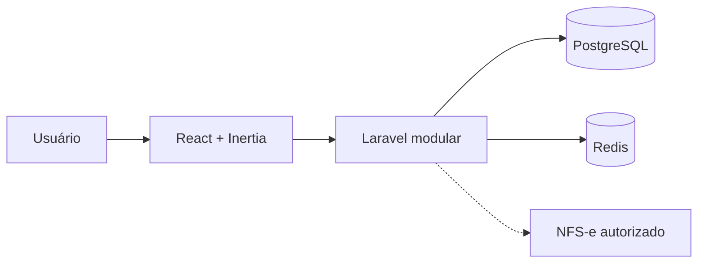

# Curupira Legal

> Seus contratos em ordem, suas finanças sob controle.

Plataforma SaaS brasileira para contratos de prestação de serviços, horas trabalhadas, cobrança recorrente, gestão financeira, tributação configurável e NFS-e.


## Estado atual

Esta primeira entrega contém a fundação visual React/Vite e a configuração inicial de PostgreSQL/Redis. A criação do scaffold Laravel foi bloqueada durante a execução porque o ambiente não conseguiu resolver `repo.packagist.org`; portanto, autenticação, APIs e persistência ainda não estão implementadas. Não trate o dashboard atual como uma aplicação autenticada ou fonte financeira.

## Stack planejada

- PHP 8.3 disponível no ambiente / Laravel 12 assim que o acesso ao Packagist for restabelecido
- PostgreSQL 16, Redis 7 e Docker Compose
- React 19, TypeScript, Vite e Lucide
- Laravel Sanctum, Fortify, Horizon, filas e Scheduler

## Rodar a interface disponível

```bash
npm install --offline
npm run build
npm run dev
```

Se o cache local não contiver alguma dependência, será necessário liberar acesso ao npm Registry. A interface é uma prévia funcional da futura área autenticada, com dados fictícios.

## Infraestrutura local

```bash
docker compose up -d postgres redis
```

As credenciais de desenvolvimento ficam em `.env.example`; copie para `.env` apenas quando o backend Laravel estiver disponível. Nunca armazene segredos, certificados ou dados reais no repositório.

## Arquitetura



Fonte editável: [`docs/diagrams/system-context.mmd`](docs/diagrams/system-context.mmd).

## Segurança e limitações

Autenticação real, isolamento multi-tenant, autorização, auditoria, cálculos fiscais e emissão NFS-e não estão ativos nesta entrega. Quando implementados, deverão ser validados por testes de feature e nunca deverão aceitar senhas gov.br, contornar MFA/CAPTCHA ou marcar documentos como autorizados sem confirmação fiscal.

## Roadmap

1. Inicializar Laravel e Inertia quando o acesso ao Composer estiver disponível.
2. Implementar identidade, organizações e isolamento de tenant.
3. Adicionar clientes, contratos, horas, billing, tributação e finanças.
4. Integrar provedores NFS-e autorizados com mock testável.
5. Consolidar relatórios, CI/CD, screenshots reais e guia de produção.

Consulte [`docs/development-progress.md`](docs/development-progress.md) para o estado verificável da execução.
