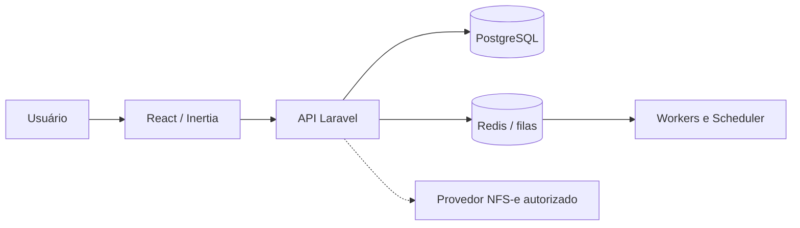

# Curupira Legal

> Seus contratos em ordem, suas finanças sob controle.

Plataforma SaaS brasileira para gestão de contratos de prestação de serviços, horas trabalhadas, cobrança, tributos, documentos fiscais e recebíveis.


## Estado atual

O projeto possui uma API Laravel funcional, persistência relacional, autenticação Fortify, isolamento por organização, módulos de clientes, contratos, apontamentos, billing, tributação, fiscal, financeiro, dashboard e relatórios CSV. Também estão configurados filas, Scheduler, Horizon, notificações, auditoria, health check, Docker e CI.

A emissão fiscal real depende de credenciais, certificados e acesso autorizado ao provedor NFS-e. O ambiente atual usa `MockFiscalProvider`: ele processa o fluxo de forma segura, mas não autoriza uma NFS-e perante a prefeitura ou a API nacional.

## Funcionalidades implementadas

- Autenticação, verificação de e-mail, 2FA, revogação de sessão e limitação de tentativas.
- Organizações, memberships, papéis, troca de organização e políticas de autorização.
- Cadastro de empresa e clientes, com validação de CPF/CNPJ.
- Contratos temporários, permanentes, por hora, preço fixo, híbridos, versões e transições de estado.
- Registro e aprovação de horas, timer, contratos faturáveis e cálculo monetário em centavos.
- Períodos de billing, snapshots imutáveis, idempotência e prevenção de duplicidade.
- Configuração fiscal efetivada por data, cálculo de retenções, tributos externos e estimativa de carga.
- Abstração de provedores NFS-e, preview, submissão mock, reconciliação e trilha fiscal.
- Contas a receber, pagamentos parciais, inadimplência, previsões e histórico financeiro.
- Indicadores do dashboard, exportações CSV, notificações agendadas e logs de auditoria.

## Tecnologia

- PHP 8.3+ e Laravel 12
- Laravel Sanctum, Fortify, Queues, Scheduler e Horizon
- PostgreSQL 16 e Redis 7
- React 19, TypeScript, Vite 8, Lucide e Tailwind CSS
- Pest/PHPUnit, testes de integração e Playwright para E2E
- Docker Compose, Nginx, GitHub Actions e armazenamento S3 compatível

## Requisitos

- PHP 8.3 ou superior com extensões `pdo_pgsql`, `pcntl`, `mbstring`, `intl` e `opcache`
- Composer 2
- Node.js 20+ e npm
- PostgreSQL 16 e Redis 7, ou Docker Desktop/Engine com Compose

## Instalação local

```bash
composer install
cp .env.example .env
php artisan key:generate
npm install
npm run build
```

Configure no `.env` a conexão PostgreSQL, Redis, mail e armazenamento. Para desenvolvimento, mantenha `APP_ENV=local` e nunca versione senhas, certificados, chaves privadas ou dados reais.

Execute as migrações:

```bash
php artisan migrate --force
```

Para criar dados fictícios de demonstração, use explicitamente o seeder de demo:

```bash
php artisan migrate:fresh --seed --seeder=DemoSeeder
```

Credenciais padrão do demo: `demo@curupira.local` / `CurupiraDemo-2026!`. Altere `DEMO_PASSWORD` antes de compartilhar o ambiente.

## Executar a aplicação

Em terminais separados:

```bash
php artisan serve
php artisan queue:work
php artisan schedule:work
npm run dev
```

O health check fica disponível em `/healthz`. A API usa o prefixo `/api/v1`; endpoints protegidos exigem autenticação e contexto de organização. O contexto pode ser selecionado com o header `X-Organization-Id` quando o usuário possui membership nessa organização.

## Docker

```bash
cp .env.example .env
docker compose up -d --build
docker compose exec app php artisan migrate --force
```

Os serviços incluem aplicação PHP, Nginx, worker, Horizon, Scheduler, PostgreSQL e Redis. A aplicação fica publicada em `http://localhost:8080`. Consulte [`docs/deployment/docker.md`](docs/deployment/docker.md) para operação, logs e solução de problemas.

O Dockerfile instala `pcntl`, requisito do Horizon. Não use `--ignore-platform-req=ext-pcntl` como correção permanente.

## Testes e verificações

```bash
php artisan test
npm run typecheck
npm run build
```

Os testes E2E usam Playwright:

```bash
npm install
npx playwright install --with-deps chromium
npm run e2e
```

O pipeline do GitHub Actions executa validação do Composer, testes Laravel, checagem TypeScript, build frontend, testes E2E e verificações de segurança. O build de produção não implanta automaticamente em produção.

## API e arquitetura

- [Especificação OpenAPI](docs/api/openapi.yaml)
- [Endpoints documentados](docs/api/endpoints.md)
- [Visão geral da arquitetura](docs/architecture/overview.md)
- [Módulos](docs/architecture/modules.md)
- [Decisões arquiteturais](docs/architecture/decisions.md)
- [Schema do banco](docs/database/schema.md)
- [Diagrama de contexto](docs/diagrams/system-context.mmd)



## Regras de negócio e fiscal

- [Regras de contratos](docs/contracts/business-rules.md)
- [Cálculos de billing](docs/billing/calculations.md)
- [Motor de tributação](app/Domain/Taxation/TaxEngine.php)
- [Integração NFS-e](docs/fiscal/nfse-integration.md)
- [Contas a receber](docs/finance/receivables.md)
- [Exportações](docs/reports/exports.md)

O motor fiscal é configurável e versionado por vigência. Não há alíquota universal embutida. A configuração de produção deve ser revisada por contador e validada conforme município, regime, serviço, competência e condições de retenção.

O sistema não coleta senha do gov.br, não contorna MFA ou CAPTCHA e não trata login no portal como autorização para API de terceiros. Quando não houver integração autorizada, deve ser utilizado o fluxo manual assistido documentado.

## Segurança, LGPD e operação

- [Modelo de segurança](docs/security/security-model.md)
- [Auditoria e compliance](docs/security/audit.md)
- [Docker](docs/deployment/docker.md)
- [Produção e backup](docs/deployment/production.md)
- [CI/CD](docs/deployment/ci-cd.md)
- [Testes E2E](docs/testing/e2e.md)

Dados financeiros e fiscais finalizados não devem ser alterados silenciosamente. Certificados digitais devem ser armazenados somente por metadados e integrações seguras; segredos pertencem ao ambiente de execução.

## Screenshots e dados de demonstração

As imagens em `docs/screenshots/` só devem ser apresentadas como screenshots do sistema quando capturadas da aplicação em execução. Dados de demonstração precisam ser fictícios; não inclua CPF/CNPJ real, certificados, clientes ou valores de produção.

## Roadmap

1. Validar o ambiente Docker em cada alvo de desenvolvimento e produção.
2. Consolidar as telas autenticadas React/Inertia sobre os endpoints existentes.
3. Implementar e homologar provedores NFS-e autorizados por município/API nacional.
4. Expandir exportações PDF/Excel, observabilidade e métricas operacionais.
5. Executar revisão final de segurança, desempenho, backups e preparação para go-live.

O progresso verificável fica em [`docs/development-progress.md`](docs/development-progress.md), com limitações e resultados de execução.

## Contribuição

Use commits Conventional Commits, atualize os testes e a documentação junto com cada funcionalidade e não inclua segredos no repositório. Consulte [`CONTRIBUTING.md`](CONTRIBUTING.md) e [`SECURITY.md`](SECURITY.md).

## Licença

Nenhuma licença open source foi definida neste repositório. A utilização e distribuição devem aguardar uma decisão explícita do proprietário do projeto.
